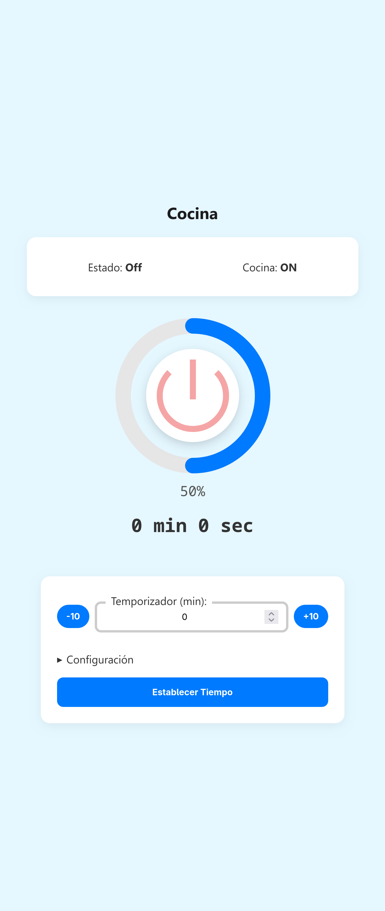
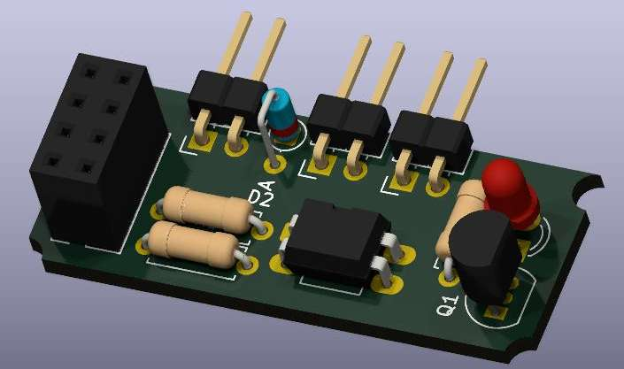

<div align="center">
<h3>ESP01S controlled for a Resistive Element (Kitchen)</h3>

</div>

---



## Goal

Controlling a resistive AC heating element using an SSR (Solid State Relay) controlled by a ESP01 (or ESP01S, ESP8266 based board)

* Push-button On/Off :heavy_check_mark:
* App Control (On/Off, Timer, Dimmer) :heavy_check_mark:
* OTA Update
* Translations :x:
* CI/CD (Github Actions) :heavy_check_mark:

## Build

```
arduino-cli compile --fqbn esp8266:esp8266:generic:eesz=1M64 ESP01S-Kitchen

arduino-cli upload -p /dev/ttyUSB0 --fqbn esp8266:esp8266:generic:eesz=1M64 ESP01S-Kitchen

mklittlefs -c ESP01S-Kitchen/data -p 256 -b 4096 -s 0x10000 littlefs.bin

esptool.py --port /dev/ttyUSB0 write_flash 0xEB000 littlefs.bin
```

## Board and Schematics

[Articulo del Esquemático](https://jackestar.netlify.app/Blog/Kicad/ESP01S-Kitchen-Driver.html)



[Kicad Project](Kicad)

# License

**This Repo** - MIT License

**ESP8266 RTOS SDK** - Apache 2.0

**Material Symbols / Material Icons** - Apache 2.0